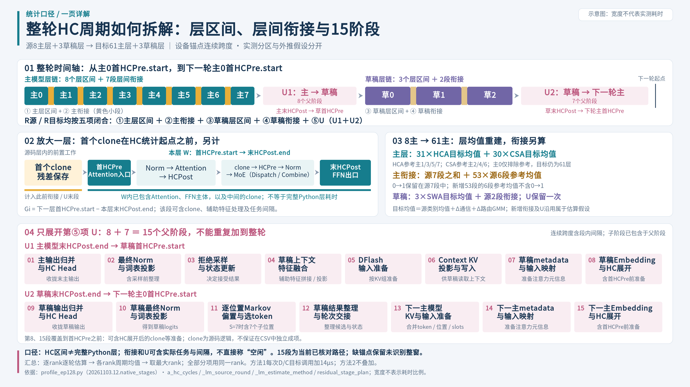

# HC周期拆解：一页详解归档

归档日期：2026-11-04。以下四个文件保存此前交付版本，PPTX 中的形状和文字可编辑。

- [PowerPoint 源文件](HC周期拆解_一页详解_20261104.pptx)
- [PDF 导出版](HC周期拆解_一页详解_20261104.pdf)
- [PNG 预览](HC周期拆解_一页详解_20261104.png)
- [SVG 矢量版](HC周期拆解_一页详解_20261104.svg)

图中覆盖源 8 主层 + 3 草稿层的 HC 周期、层区间边界、层间衔接、U1/U2 的 15 阶段，以及主模型 8→61 层的外推关系。时间线宽度表示结构，不表示实测耗时比例。

关于“完整周期分解，不等于互斥kernel占用”的准确解释：**周期各时间区间互斥且完整覆盖；区间内部允许多流 kernel 重叠执行。** 它不表示五项时间重复计数，也不表示每类区间都对应独占设备的 kernel 类别。

单层采用“首 HCPre 开始→末 HCPost 结束”的设备统计边界，不等同完整 Python forward。层间衔接可能包含记录任务，不能直接称为空闲。U 的 15 阶段只对 U 进一步展开，不额外加一次。

版本和校验值见 [versions.json](../versions.json)。公式以当前 [README](../../README.md) 和核心代码为准；实测与外推假设应分开阅读。
